# FigurePlay · 论文子图排版工具

> 在浏览器或 Windows 桌面窗口中完成论文子图的行列排列、合并单元格、多页图集、子图分组、统一编号与高清导出的本地工具。
> 无需安装、无需联网；桌面版额外支持从 MATLAB 图窗直接粘贴（含 EMF 图元）与直接读取 `.fig` 文件。

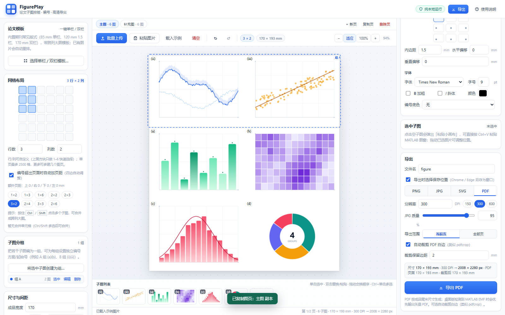

---

## 快速开始

**方式一：网页版（推荐日常使用）**

双击 `启动FigurePlay.bat`，会优先用 Chrome / Edge 打开 `index.html`。

**方式二：桌面版（推荐 MATLAB 图窗粘贴 / .fig）**

双击 `启动FigurePlay桌面版.bat`，或直接运行 **`desktop\dist-single\FigurePlay.exe`**（单文件版，目录里只有这一个 exe，约 800 KB）。

- 桌面版使用 Windows 自带的 WebView2 内核，以独立窗口打开，不显示浏览器地址栏；
- 支持读取 Windows 系统剪贴板中的 **EMF 图元**（MATLAB「Copy Figure」默认格式），自动转为高清 PNG；
- 支持直接拖入 / 选择 **MATLAB `.fig` 文件**：自动调用本机 MATLAB 后台导出为高清 PNG，再填入子图；
- 需要系统已安装 **WebView2 Runtime**（Windows 10/11 一般已随 Edge 安装；缺失时程序会给出下载提示）；
- 未签名 exe 首次运行可能触发 SmartScreen：点「更多信息 → 仍要运行」即可；当前为 v1.4.0。

> 单文件版首次启动会把内部资源解压到 `%LOCALAPPDATA%\FigurePlay\bin\app-<哈希>`，之后复用；升级换版本会自动清理旧目录。多文件版仍保留在 `desktop\dist\FigurePlay.exe` 供调试/分发。
> 两种方式共用同一套网页代码和本地数据目录行为；所有图片仅在本地处理，不会上传。

---

## 功能一览

### 1. 网格排列

- 左侧 **行列矩阵选择器**：直接框选「几行 × 几列」；行/列也可在数字框自定义（1–500，单页最多 2500 格），不再限制 6×6。
- 成品宽度（mm）、子图宽高比、列/行间距、外边距均可调；高度自动计算。**列/行间距支持负值（-50～80 mm）**，图片自带空白边距时可设为负值让画面更紧凑/轻微重叠。选中/悬停描边已移到最上层，负间距重叠时也不会被相邻子图盖住。

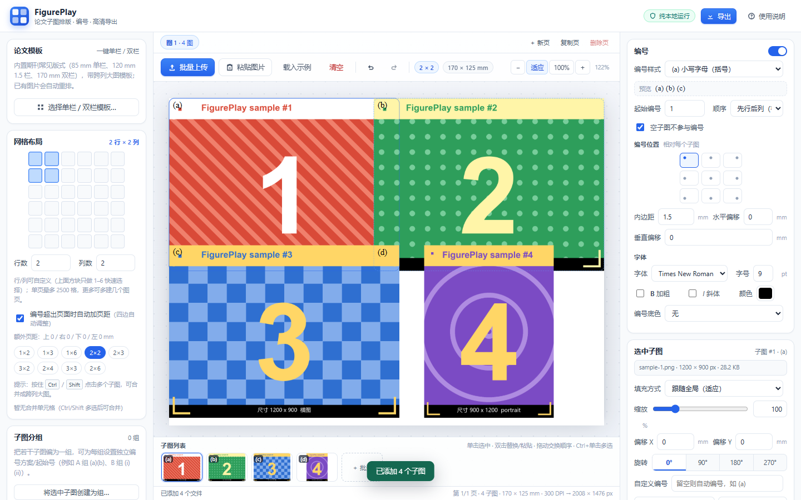
- 每个子图可单独设置：**填充方式**（适应 / 填满裁剪 / 拉伸）、**缩放**、**旋转**、**水平/垂直偏移**。
- 选中图片后可直接拖动平移、滚轮缩放、方向键微调；缩略图列表支持拖动交换顺序。

### 2. 合并单元格 / 跨列大图（v1.1 新增）

- 按住 `Ctrl` 或 `Shift` 点击多个子图进行多选，点击「**合并为跨列大图**」即可把矩形区域合并为一个面板（支持跨列、跨行，如 2×3 首行跨 3 列、左列跨 2 行）。
- 合并后的面板作为一个整体：上传/粘贴一张图、只编一个编号、导出时也只有一个图像区域。
- 左侧「网格布局」卡片会列出当前所有合并单元格，可逐个「拆分」或「全部拆分」。
- 选中的合并面板可在右侧「选中子图」中一键拆分。
- 合并规则：所选子图必须组成完整矩形，且不能嵌套合并；若选区中有多张图片，合并时只保留左上角那张（会二次确认）。

### 3. 一键单栏 / 双栏模板（v1.1 新增）

点击左侧「**选择单栏 / 双栏模板…**」，内置 8 种期刊版式：

| 模板 | 版式 |
| --- | --- |
| 单栏 · 单图 | 85 mm · 1 × 1 |
| 单栏 · 上下两图 | 85 mm · 2 × 1 |
| 1.5 栏 · 2×2 | 120 mm · 2 × 2 |
| 双栏 · 2×3 | 170 mm · 2 × 3 |
| 双栏 · 3×2 | 170 mm · 3 × 2 |
| 双栏 · 2×2 | 170 mm · 2 × 2 |
| 双栏 · 大图 + 三小图 | 170 mm · 2×3，首行跨 3 列 |
| 双栏 · 左大图 + 右四图 | 170 mm · 2×3，左列跨 2 行 |

应用模板时，已有图片会按顺序自动重排到新面板；图片多于新面板时会丢弃多余的并提示。

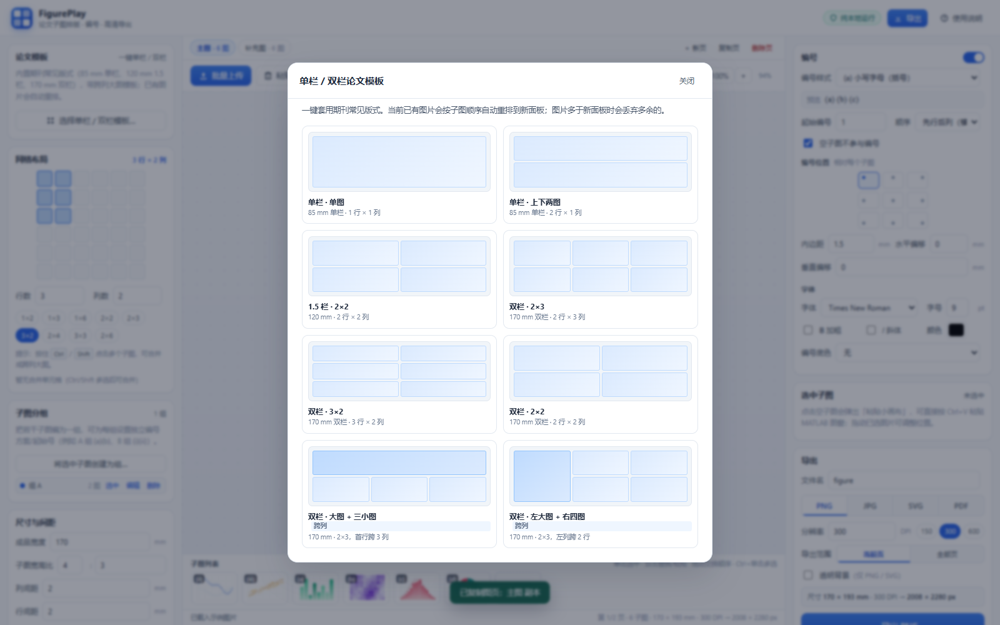

### 4. 多页工程与子图分组（v1.2 新增）

**多页工程（跨页）**

- 预览区顶部新增**图页栏**：`＋ 新页` 新建空白页（沿用当前网格与编号设置）、`复制页` 完整复制当前页、`删除页`；双击页签可重命名。
- 每页有独立的网格、子图、合并、编号与分组，互不影响；`Ctrl + PageUp / PageDown` 可快速切页。
- 导出范围可选 **当前页** 或 **全部页**：
  - **PDF**：全部页合成为一个**多页 PDF**（每页保留各自毫米尺寸）；
  - **PNG / JPG / SVG**：每页分别导出并**打包成 ZIP**下载（文件名 `<原文件名>-p01.png` 等）。
- 整个工程（所有页）统一自动保存，刷新/重开桌面版后恢复。

**子图分组**

- 按住 `Ctrl`/`Shift` 多选子图 → 左侧「**将选中子图创建为组…**」→ 设置组名、编号样式、起始号。
- 每组使用**独立编号**：例如 A 组用 `(iii)(iv)`，B 组用 `(a)(b)`，未分组子图继续使用全局编号。
- 左侧分组列表支持 **选中**（快速多选该组）、**编辑**（改组名/方案/起始）、**删除**。
- 预览中会用彩色虚线框 + 组名标出分组；这些只是编辑辅助，**不会进入导出**。
- 合并同一组的子图时，合并后的大图会保留该组归属；套用模板/改变网格会自动清理失效的分组。

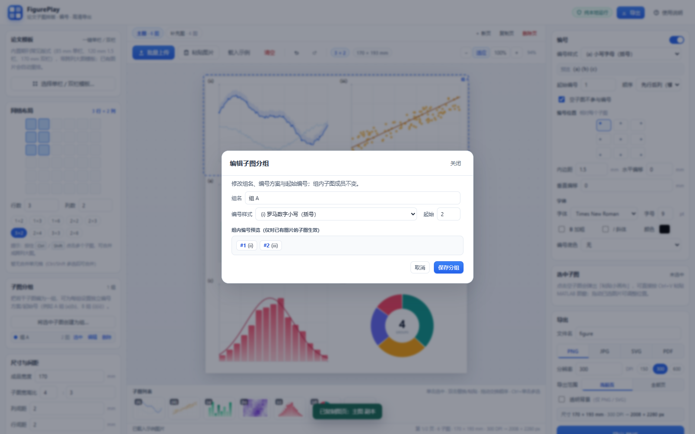

### 5. 撤销 / 重做（v1.2 新增）

- 顶部工具栏新增撤销 / 重做按钮，键盘 `Ctrl + Z` 撤销、`Ctrl + Shift + Z` / `Ctrl + Y` 重做。
- 覆盖：上传/粘贴、删除、移动/缩放/旋转、网格与模板、合并/拆分、编号、分组、图页增删改名等。
- 连续拖动/缩放会在停止约 0.5 秒后合并成一步，撤销不会一次跳很多步；最多保留 40 步。
- 弹窗或文本输入框打开时，`Ctrl + Z` 保留给输入框自身使用。

### 6. 上传图片与「粘贴小画布」

- 点击空子图 → 弹出**粘贴小画布**：按 `Ctrl + V` 直接粘贴剪贴板图片，也可拖入文件或「选择本地图片」。
- 顶部「批量上传」按顺序填充空位；把文件拖入某个子图也可替换。
- 粘贴小画布支持：
  - **继续粘贴**：确认后自动跳到下一个空子图（适合连续粘贴多张 MATLAB 图窗）；
  - **替换已有图片**：双击已填子图或点右侧「粘贴 / 替换…」；
  - 预览确认、重新粘贴、取消。
- 支持格式：**PNG、JPG/JPEG、WebP、GIF（第一帧）、BMP、SVG、TIFF**（TIFF 支持 LZW / Deflate 等常见压缩）；桌面版额外支持 **MATLAB `.fig`**。
- 桌面版可把 `.fig` 直接拖到窗口/子图，或通过「批量上传」「粘贴小画布 → 选择本地图片」选择；程序会调用本机 MATLAB（R2020a+）在后台转换为 300 DPI PNG，首次转换可能需要 1–2 分钟。

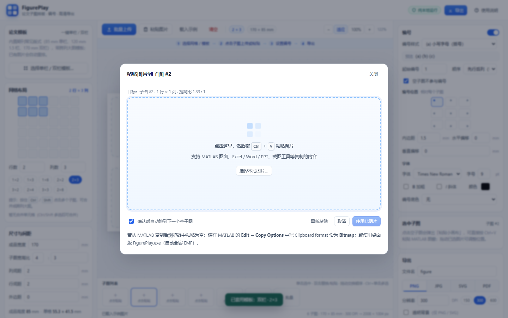

#### MATLAB 图窗快速导入（重点）

1. 在 MATLAB 图窗中点击 **编辑(Edit) → 复制图窗(Copy Figure)**；
2. 切到 FigurePlay **桌面版**，点击任意空子图（或按 `Ctrl + V`）；
3. 粘贴小画布会自动读取系统剪贴板，将 EMF 图元转为高清 PNG 预览，并**保留 EMF 原始矢量数据**；预览确认后按 `Enter` /「使用此图片」填入；
4. 勾选「确认后自动跳到下一个空子图」可连续完成多张图：复制 → 粘贴 → Enter → 复制下一张…
5. 导出 PDF 时，桌面版会自动调用 PowerPoint 排版引擎把 EMF 作为**矢量**放入 PDF；线条与文字放大不会出现马赛克。**首次会启动 PowerPoint（约 20–40 秒），之后桌面版会复用同一个隐藏 PowerPoint 会话，实测热导出约 0.5–1 秒**；没有安装 PowerPoint 或对图片使用了裁剪/旋转/偏移时会自动回退高分辨率位图 PDF。

> 浏览器版通常无法直接识别 MATLAB 默认的 EMF 剪贴板格式。若使用网页版，请在 MATLAB 的 **Edit → Copy Options → Clipboard format** 中改为 **Bitmap**，或直接使用桌面版。

### 7. 编号

- **编号样式（14 种）**：`(a)` `a)` `a.` `a`、`(A)` `A)`、`(i)` `i)`、`(I)` `I)`、`(1)` `1)` `1.` `1`。
- 起始编号、行优先/列优先、空子图是否跳过均可设置。
- **编号位置**：9 个锚点统一设置（左上 / 上中 / 右上 / 左中 / 居中 / 右中 / 左下 / 下中 / 右下），支持内边距与偏移。
- **编号越界保护（v1.3 新增）**：默认勾选「编号超出页面时自动加页距」；检测到编号可能超出页面时，会自动在对应边增加页距，保证导出的 PDF/图片中编号完整。关闭自动后可手动填写上/右/下/左页距。

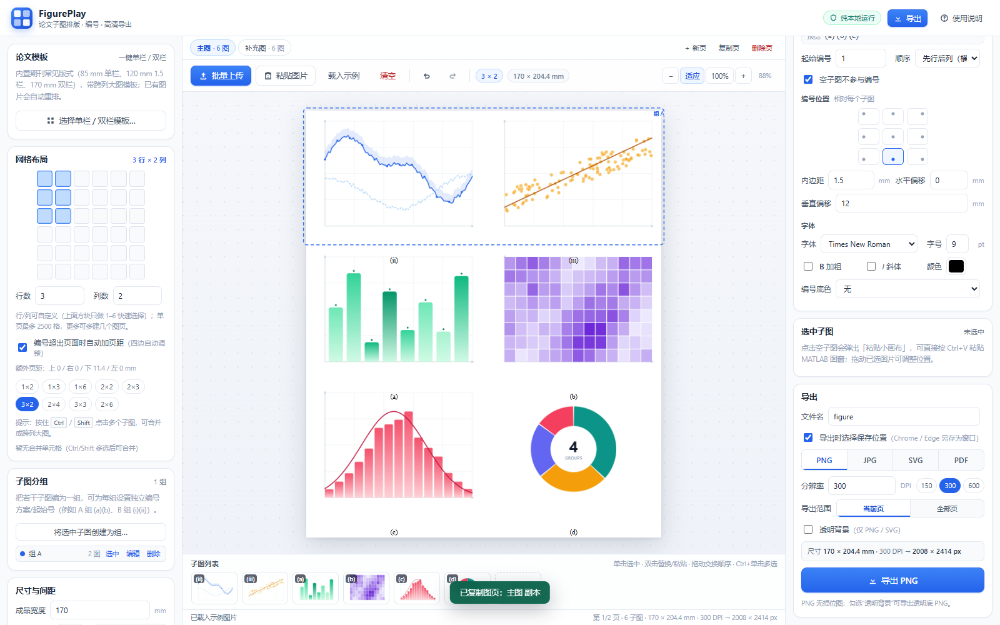
- 字体、字号（pt）、加粗、斜体、颜色、底色与不透明度可调。
- 单个子图可填自定义编号；多选后可**批量套用编号**（v1.1 新增）：选择编号方案与起始值，实时预览将写入的编号，一键应用到所有选中并已有图片的子图；也可批量清除自定义编号恢复自动编号。

### 8. 导出

| 格式 | 说明 |
| --- | --- |
| **PNG** | 无损位图，支持透明背景，适合直接投稿 |
| **JPG** | 不支持透明（背景使用当前背景色），体积小，质量 60%–100% 可调 |
| **SVG** | 矢量格式，编号为可编辑文字，可继续在 Illustrator / Inkscape 中编辑 |
| **PDF** | 按毫米尺寸生成 PDF；桌面版对 EMF 优先输出矢量 PDF；可选自动裁剪白边 |

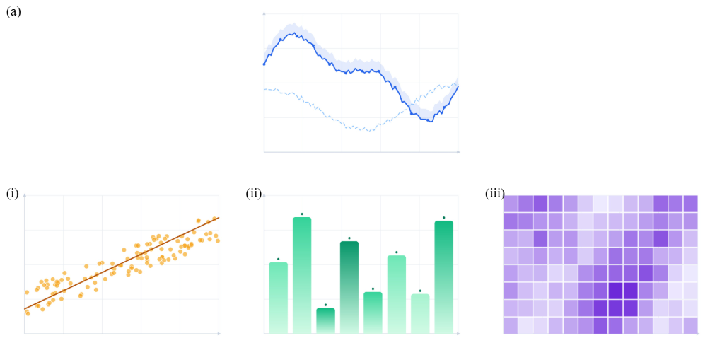

*上图为「双栏 · 大图 + 三小图」+ 子图分组的导出示例：首行跨 3 列编为 (a)，下排三图独立使用 (i)(ii)(iii)。*

- 分辨率预设 150 / 300 / 600 DPI，也可自定义 36–1200 DPI；实时显示导出像素尺寸。
- **保存位置（v1.3 新增）**：导出设置中可勾选「导出时选择保存位置」，Chrome / Edge 会弹出另存为窗口，可直接选择文件夹与文件名；不支持时回退到默认下载目录。
- **界面外观（v1.3.4 新增）**：顶栏调色板按钮支持**浅色 / 深色 / 跟随系统**三种模式，以及蓝、靛蓝、青绿、翠绿、紫罗兰、玫红、琥珀七种主题色。设置保存在本机浏览器，重启后保留；跟随系统会随 Windows 主题实时切换。切换只更新 CSS 变量和 `data-*` 属性，不重绘画布、不触发应用渲染，也不改变导出图的颜色。
- **矢量 PDF 编号位置（v1.4.0 修复）**：PowerPoint 在 `WordWrap=false` 时会把新建文本框宽度压缩到极小，导致编号整体偏离预览；v1.4.0 改为按真实锚点定位、写入文本后重新写回文本框几何并重设对齐，实测编号中心误差 ≤0.03mm（3×2、Arial 11pt、底部编号）。
- **PDF 白边裁剪（v1.3.2 改进）**：勾选「自动裁剪 PDF 白边」后，按**实际内容墨迹边界**（而不是面板矩形）裁剪页面，会连 MATLAB 图自身的白底、适应显示产生的上下/左右留白一起裁掉，类似 `pdfcrop`；可设置保留边距（0–20 mm）。为避免底部编号边缘被裁，**0 mm 会自动保留约 1 mm 防裁字安全边距**，并额外按编号排版盒外扩；默认关闭，多页 PDF 支持逐页裁剪。
- **矢量 PDF（v1.3 新增）**：桌面版从 MATLAB Copy Figure 粘贴的 EMF 会保留矢量；导出 PDF 时自动尝试 PowerPoint 矢量排版，放大不糊。失败时回退位图并在界面提示。
- 滑块（JPG 质量、编号底色不透明度、子图缩放）旁都有数字输入框，可直接输入数值，和拖动滑块同步。

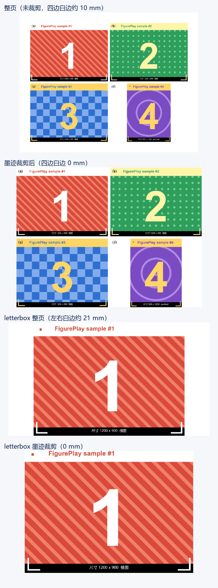

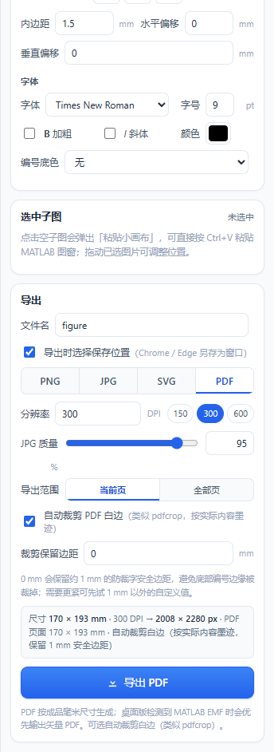

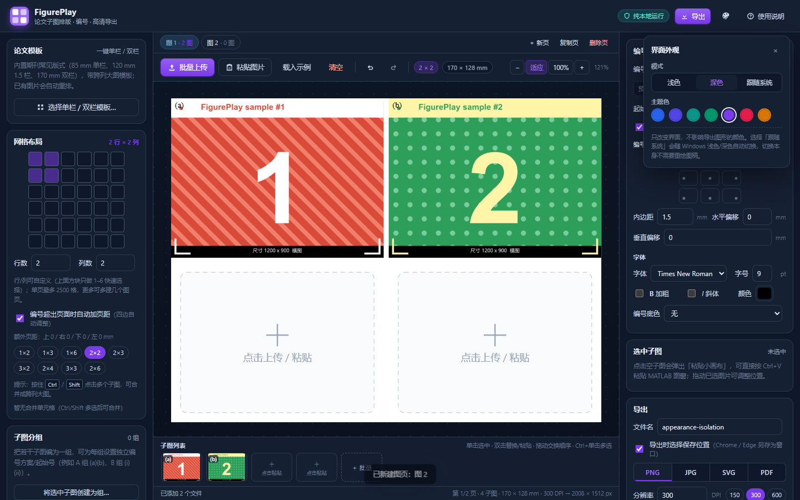

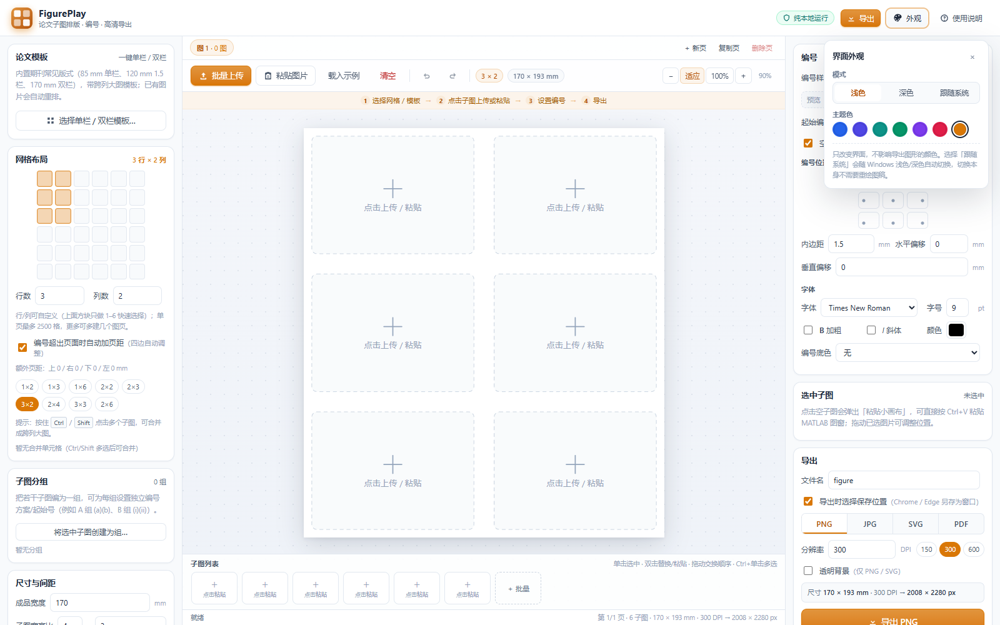
- 多页工程可选「全部页」：PDF 输出多页 PDF，其它格式输出 ZIP（每页一个文件）。
- 透明背景仅 PNG / SVG；JPG / PDF 使用当前背景色（默认白色）。
- 快速换算：**像素 = 毫米 ÷ 25.4 × DPI**。例如 170 mm × 85 mm 在 300 DPI 下 = 2008 × 1004 px。
- 期刊常见要求：位图 ≥ 300 DPI；需要矢量文字请导出 SVG。

> PDF 为保证跨平台一致性，采用「高分辨率位图 + 毫米页面」封装；需要可编辑矢量文字请用 SVG。

---

#### 9. 配置模板（v1.4.0 新增）
把当前网格、编号、字体、间距和导出设置保存为主题配置，下次换一批图时一键套用；配置**不包含图片**，只保存排版参数。

- 本机可保存多个配置（名称 + 说明），支持应用、删除、导出 JSON；
- 导出文件为 `<名称>.figureplay.json`，可复制到另一台电脑的网页版或桌面版导入；文件内包含名称、说明、创建时间、来源版本、网格/编号/导出参数；
- 导入时先显示**名称、说明和参数摘要**，确认后再应用或保存；应用前若当前页已有图片，会提示会按顺序重排；
- 配置保存在浏览器/桌面版本地（localStorage），不随项目图片移动；跨设备请用 JSON 导出/导入。

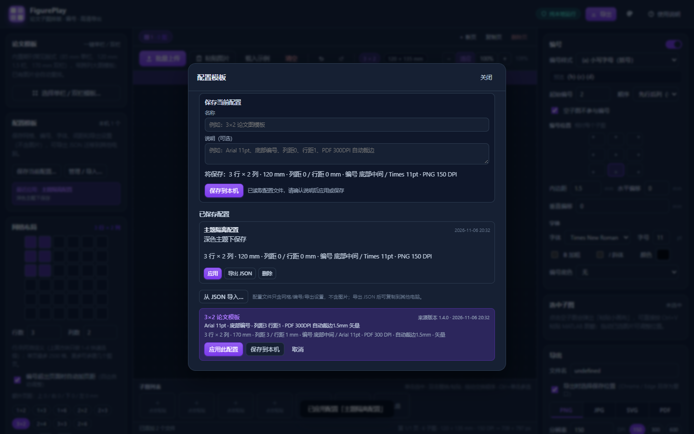

## 快捷键

| 按键 | 功能 |
| --- | --- |
| `Ctrl + V` | 打开粘贴小画布并粘贴剪贴板图片（桌面版直接读取系统剪贴板，支持 EMF） |
| `Ctrl + Z` | 撤销 |
| `Ctrl + Shift + Z` / `Ctrl + Y` | 重做 |
| `Ctrl + PageUp` / `Ctrl + PageDown` | 切换图页 |
| `Ctrl` / `Shift` + 点击子图 | 多选（用于合并、批量编号、分组） |
| `Enter`（粘贴小画布中） | 确认使用当前预览图片 |
| `Delete` / `Backspace` | 清除当前选中子图的图片 |
| `Esc` | 取消选中 / 关闭弹窗 |
| 方向键 | 选中子图后微调位置（`Shift` + 方向键快速移动） |
| 鼠标滚轮 | 选中子图后缩放图片 |
| 双击子图 | 打开粘贴 / 替换小画布 |

---

## 自动保存

- 布局、合并信息、多页工程、子图分组、图片和编号设置自动保存在本地浏览器数据库（IndexedDB），刷新页面后恢复。
- 网页版与桌面版使用各自的数据目录；桌面版 WebView2 数据在 `%LOCALAPPDATA%\FigurePlay\WebView2`。
- 桌面版单文件版自身解压在 `%LOCALAPPDATA%\FigurePlay\bin`，图片数据仍在 WebView2 数据目录；升级不会丢失工程数据。
- 如存储空间不足会提示自动保存不可用，请及时导出。

---

## 文件结构

```
E:\FigurePlay\
├── index.html                   主页面
├── 启动FigurePlay.bat           网页版启动（优先 Chrome / Edge）
├── 启动FigurePlay桌面版.bat     桌面版启动
├── README.md                    本说明
├── assets\styles.css            界面样式
├── js\
│   ├── util.js                  工具、编号方案、图片读取
│   ├── layout.js                版面几何、合并面板、图片变换、编号定位、分组编号
│   ├── desktop.js               桌面版 WebView2 桥（EMF 剪贴板 / .fig 导入）
│   ├── storage.js               本地自动保存
│   ├── render-svg.js            预览与 SVG 导出渲染（含分组虚线框）
│   ├── render-canvas.js         PNG / JPG / PDF 光栅渲染
│   ├── pdf.js                   单页 / 多页 PDF 生成器
│   ├── zip.js                   多页导出 ZIP 打包（store）
│   ├── export.js                导出编排（单页 / 全部页）
│   ├── demo.js                  示例图生成
│   └── app.js                   交互、状态、页面、分组、撤销与弹窗
├── vendor\                      TIFF / zlib 解码（MIT，许可证见目录）
├── docs\                        界面与导出示例图
├── desktop\                     桌面版源码、构建脚本与发布目录
│   ├── build.ps1                一键构建（多文件版 + 单文件版 + 自测 + zip）
│   ├── README.md                桌面版构建/分发说明
│   ├── dist\FigurePlay.exe      多文件版（旁边需 dll/wwwroot）
│   └── dist-single\FigurePlay.exe 单文件版（推荐，目录内只有该 exe）
└── _dev\                        自动化测试与素材（可安全删除，不影响程序）
```

---

## 常见问题

**Q：MATLAB「复制图窗」后在网页版粘贴为空？**
MATLAB 默认复制 EMF 图元，浏览器剪贴板通常拿不到。请改用桌面版，或在 MATLAB 的 `Edit → Copy Options` 中把 Clipboard format 设为 Bitmap。

**Q：怎么直接打开 .fig 文件？**
使用桌面版 FigurePlay.exe，把 `.fig` 拖进窗口或通过「批量上传 / 粘贴小画布 → 选择本地图片」选择即可；程序会调用本机 MATLAB（R2020a+）后台转成 300 DPI PNG。首次转换因 MATLAB 冷启动可能需 1–2 分钟，之后会快很多。网页版不支持 `.fig`。

**Q：两组子图想分别用 (a)(b) 和 (i)(ii) 怎么设？**
多选第一组子图 → 左侧「子图分组」创建分组，编号样式选 `(i)`、起始 1；再选第二组创建另一个组并选 `(a)`。未分组子图继续用右侧全局编号。

**Q：桌面版提示缺少 WebView2 Runtime？**
安装 Microsoft Edge WebView2 Runtime（免费）后重试；Windows 10/11 一般已随 Edge 安装。

**Q：桌面版 exe 被 SmartScreen 拦截？**
exe 未做代码签名。点击「更多信息 → 仍要运行」；如单位有要求可自行签名。

**Q：导出的编号字体和预览不一致？**
编号使用本机已安装字体渲染。论文场景建议 Times New Roman（Windows 自带）。

**Q：Word 插入 SVG 显示不正常？**
Word 2016 及以上支持 SVG；旧版本请使用 PNG（300 DPI 以上）或转存 PDF/EMF。

**Q：PDF 里的编号能编辑吗？**
PDF 是位图封装，编号已光栅化；需要可编辑文字请导出 SVG。

**Q：导入的 TIFF 方向不对？**
极少数带方向标记的 TIFF 可能无法自动识别，可先转换/旋转后导入，或导入后在程序内使用「旋转」校正。

**Q：会联网吗？**
不会。所有 HTML/JS 均在本文件夹内，图片处理完全本地完成。

---

## 验证

- **网页版 E2E：24/24 场景、865/865 断言全部通过**，0 页面 JS 错误、0 控制台 error、0 资源加载失败；覆盖 v1.0 基础、v1.1 合并/模板/批量编号/粘贴、v1.2 多页/分组/撤销/多页导出/.fig、v1.3 网格自定义/保存位置/编号越界自动页距/滑块数字输入、v1.3.1 按实际墨迹裁剪 PDF 白边/EMF 矢量 PDF mock、v1.3.2 编号防裁安全边距/负间距、v1.3.3 负间距重叠时选中/悬停顶层描边、v1.3.4 浅色/深色/跟随系统/主题色与导出隔离、v1.4.0 配置模板保存/应用/JSON 导入导出。
- **桌面版 selftest：v1.4.0 多文件版与单文件版均 exit 0**；三栏布局、真实 EMF→4,400 px 预览、真实 MATLAB `.fig`、PowerPoint 矢量 PDF（pdfimages 无位图、编号安全边距、编号中心误差 ≤0.03mm）、持久 PowerPoint 复用（冷导出约 28–31 s，热导出约 0.5–0.8 s，约 97–98% 提升）、WebView2 深色/主题色冒烟、EMF 矢量 app→host 端到端、console error 0 全部通过。
- 详细报告：[`_dev/report-v1.4.0.md`](_dev/report-v1.4.0.md)（含完整断言明细、主题/导出隔离证据、冷/热耗时、导出校验、冻结哈希与复现命令）；测试截图与样例在 `_dev\screens-v1.4.0` 与 `_dev\artifacts\e2e-v140`。

---

## 版本管理

本项目已在 `E:\FigurePlay` 初始化 Git 仓库，源码、文档、测试脚本和构建脚本均纳入版本追踪；`dist/`、`selftest/`、打包 zip、`_dev/artifacts` 与测试截图等可再生成的大文件不进入 Git（见 `.gitignore`）。

常用命令：

```powershell
Set-Location E:\FigurePlay
git status
git log --oneline --decorate -10
git diff
git add -A
git commit -m "说明这次修改"
```

当前基线提交带标签 `v1.4.0`，对应“配置模板保存/导入 + 浅色/深色/跟随系统 + 七种主题色 + 持久 PowerPoint 加速矢量 PDF + 负间距顶层描边 + 编号防裁安全边距 + 按实际墨迹裁剪 PDF 白边 + 保存位置 + 自定义网格”的版本。

## 第三方组件

- [UTIF.js](https://github.com/photopea/UTIF.js) —— TIFF 解码，MIT License
- [pako](https://github.com/nodeca/pako) —— zlib/Deflate，MIT License
- [Microsoft.Web.WebView2](https://learn.microsoft.com/microsoft-edge/webview2/) —— 桌面版外壳（NuGet 分发，许可随包）

许可证原文见 `vendor/` 与 `desktop/dist/`。

---

FigurePlay v1.4.0 · 本地运行 · 无网络依赖
